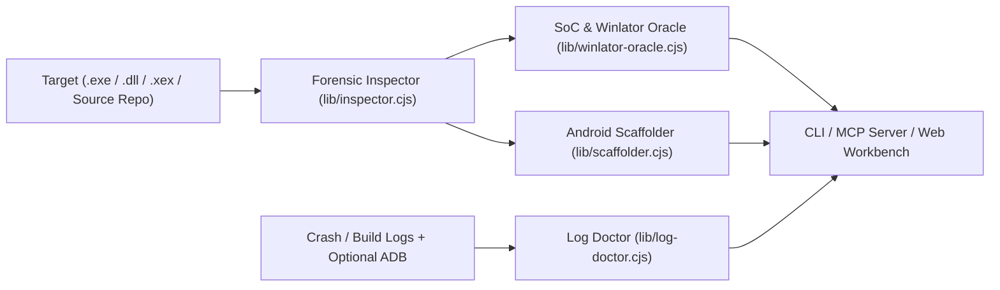

# Port-Forge

**Unified Cross-Platform Porting Studio & MCP Server** for migrating PC software, Windows games, and Xbox 360 static recompilation targets to Android (`APK`, `NDK + SDL2 + Vulkan`, `Capacitor`, `Buildozer`, `XenonRecomp ARM64`, and tuned `Winlator / Box64 / FEX / DXVK` containers).

Built with **zero external npm runtime dependencies** on Node.js `>=18` — ready for CLI workflows, AI coding agents (`Codex`, `Gemini CLI`, `Claude Code`, `Claude Desktop`, `OpenBot` via `stdio` MCP + portable `SKILL.md`), and a local browser workbench.

---

## Why Port-Forge?

Community feedback across `r/EmulationOnAndroid`, `r/winlator`, `XenonRecomp`, and native NDK porting repos highlights four recurring bottlenecks:
1. **Trial-and-Error Configuration Hell:** Changing 10+ runtime variables at once (`Turnip` vs `Vortek`/`VirGL`, `DXVK > 2.4.1` timeline semaphore freezes on Adreno 6xx/Mali, `Box64` dynarec flags, Unity `-force-gfx-direct`, `dxvk.async` shader stutter).
2. **Binary & Codebase Blindness:** Before writing a single line of NDK or container glue, engineers need to know exact PE32/PE32+ DLL imports (`d3d9/11/12`, `UnityPlayer`, `XInput`, `EasyAntiCheat`) or Xbox 360 `.xex` headers.
3. **Static Recompilation Friction:** Porting PowerPC (`XenonRecomp` / `XenosRecomp`) to Android ARM64 requires deterministic Big-Endian byte swaps, `VMX128 -> ARM NEON` vector mappings, `SPIR-V` offline shader pipelines, and SELinux `mprotect` / 16KB page safety.
4. **Disconnected Crash Loops:** Reading `adb logcat`, `WINEDEBUG`, `BOX64`, `VK_ERROR_DEVICE_LOST`, and CMake linker errors manually wastes hours.

Port-Forge unifies all four stages into one deterministic toolchain.

---

## Architecture



### Core Capabilities
- **Forensic Target Inspector (`lib/inspector.cjs`):** Pure Node.js binary PE32/PE32+ import-table parser, Xbox 360 `XEX2` header inspector, and multi-stack source fingerprinter (`C++/Win32/DirectX`, `Electron`, `Python`, `Godot`, `Unity`, `XenonRecomp`).
- **SoC & Winlator Compatibility Oracle (`lib/winlator-oracle.cjs`):** Generates hardware-aware presets for `adreno-7xx` (Turnip), `adreno-6xx` (DXVK <=2.4.1 pin), `mali-immortalis` (Vortek/VirGL), and `xclipse-rdna`, including `dxvk.conf`, `Box64`/`FEX-Emu` variables, `.wcp` manifest, and Winlator `.container` JSON.
- **Multi-Stack Scaffolder (`lib/scaffolder.cjs`):** Emits ready-to-customize projects for `android-ndk-sdl2`, `xenon-recomp-arm64`, `capacitor-android`, `buildozer-kivy`, `godot-android-export`, `unity-android-export`, and `winlator-container`.
- **Log Doctor & Optional ADB Bridge (`lib/log-doctor.cjs`):** Diagnoses `VK_ERROR_DEVICE_LOST`, Box64 `SIGILL`, Unity `GfxDeviceWorker` deadlocks, NDK missing link targets, Android 16KB ELF / `mprotect` issues, and probes connected `adb` devices safely when `adb` is present on `PATH`.
- **CLI + `stdio` MCP Server + Web Workbench (`http://127.0.0.1:4380`) + Portable Skill (`skill/SKILL.md`).**

---

## Quick Start

```bash
# Clone the repository
git clone https://github.com/deusbr/port-forge.git
cd port-forge

# Verify syntax and run all unit/integration tests
npm run check
npm test
```

### CLI Usage

```bash
# 1. Inspect a local Windows binary, Xbox .xex, or source directory
node bin/port-forge.cjs inspect ./path/to/MyGame.exe --save

# 2. Generate a SoC-specific Winlator / Box64 / DXVK runtime preset
node bin/port-forge.cjs oracle --target ./path/to/MyGame.exe --soc adreno-6xx --runtime winlator-cmod --goal stability

# 3. Generate an Android NDK + SDL2 + Vulkan or XenonRecomp ARM64 scaffold
node bin/port-forge.cjs scaffold --strategy android-ndk-sdl2 --out ./android-port --name StarPort

# 4. Diagnose crash or build logs
node bin/port-forge.cjs diagnose ./crash.log

# 5. Launch the local Web Workbench (http://127.0.0.1:4380)
node bin/port-forge.cjs web --port 4380

# 6. Install MCP server & skill into Codex, Gemini CLI, Claude Code, and Claude Desktop
node bin/port-forge.cjs install
```

---

## MCP Tools (`port-forge-mcp`)

| Tool | Purpose |
| :--- | :--- |
| `port_inspect_target` | Parse PE32/PE32+ DLL imports, `XEX2` headers, or source repositories (`C++`, `Electron`, `Python`, `Godot`, `Unity`, `XenonRecomp`). |
| `port_recommend_runtime` | Emit tailored `Turnip`/`Vortek`, `Box64`/`FEX`, `DXVK` pins, `dxvk.conf`, and launch flags by SoC. |
| `port_generate_scaffold` | Write Android NDK/SDL2, XenonRecomp ARM64, Capacitor, Buildozer, Godot/Unity, or Winlator preset scaffolds. |
| `port_diagnose_log` | Detect root causes across `logcat`, `WINEDEBUG`, `BOX64`, Vulkan validation, and CMake/NDK logs. |
| `port_adb_probe` | Query connected Android devices/emulators (`abi`, `socModel`, `hardware`) when `adb` is installed. |
| `port_list_projects` | List saved porting workspaces in `~/.port-forge`. |
| `port_get_project` | Read inspection, oracle config, and log diagnosis history for a project. |
| `port_start_web` | Start the local `127.0.0.1` Port-Forge Web Workbench. |

---

## Legal Notice

Port-Forge analyzes and scaffolds **only legally owned user source code, binaries, and game files supplied locally by the operator**. This repository contains **zero** copyrighted ROMs, BIOS dumps, firmware, proprietary SDK binaries, or decryption keys.

## License

[MIT](LICENSE) — Emerson Almeida ([@deusbr](https://github.com/deusbr))
